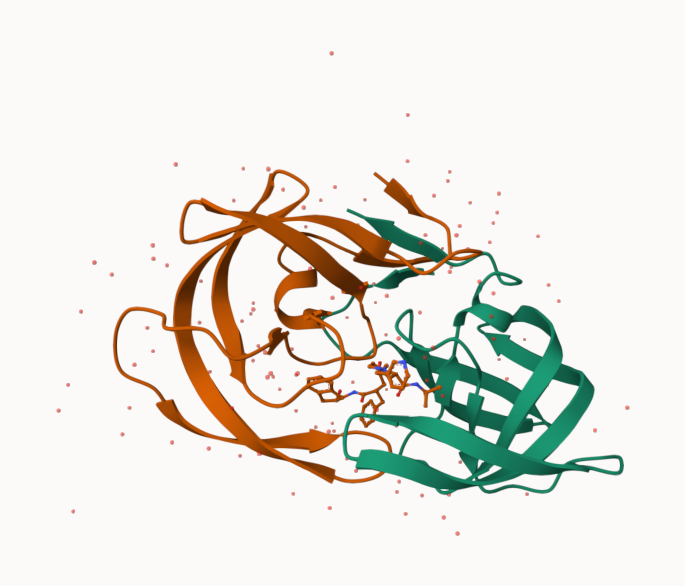
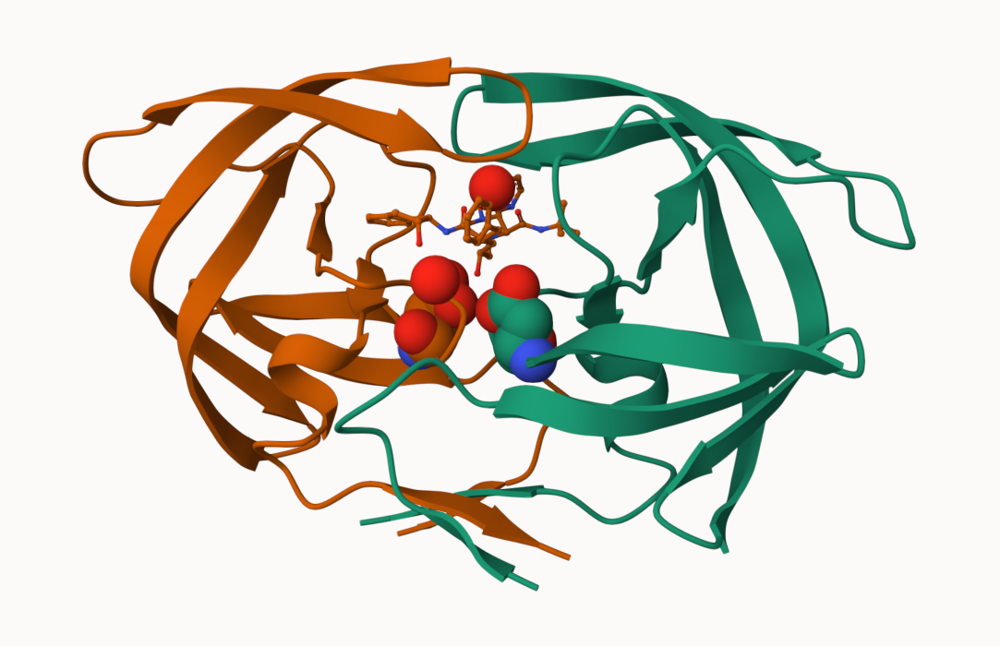
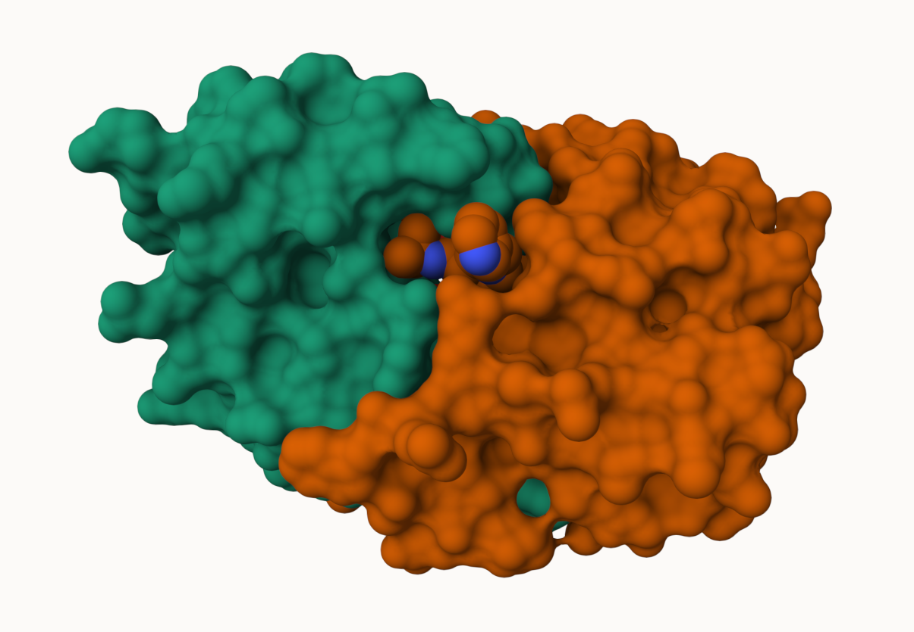

## Background 

The [PDB database](http://www.rcsb.org/) is the main repository of the biomolecular structure information. Let's have a look at the composition of this database: 

Visit PDB and Click: 
Analyze > PDB Statistics > Experimental Method > Summary 

We can "scrape" data from this page with the **datapasta** package that we can install from CRAN `install.packages("datapasta")`

Then "Addins > Paste as data.frame": 

```{r, echo=FALSE}
pdb <- data.frame(
  stringsAsFactors = FALSE,
       check.names = FALSE,
           Molecular.Type = c("Protein (only)",
                              "Protein/Oligosaccharide","Protein/NA",
                              "Nucleic acid (only)","Other","Oligosaccharide (only)",
                              "Total"),
         `X-ray.▼` = c(184731, 10716, 9341, 3216, 178, 11, 208193),
                EM = c(25754, 4037, 7520, 347, 27, 1, 37686),
               NMR = c(12904, 34, 288, 1599, 35, 6, 14866),
       Integrative = c(365L, 8L, 27L, 3L, 4L, 0L, 407L),
  Multiple.methods = c(232L, 11L, 8L, 15L, 0L, 1L, 267L),
           Neutron = c(86L, 1L, 0L, 3L, 0L, 0L, 90L),
             Other = c(32L, 0L, 0L, 1L, 0L, 4L, 37L),
             Total = c(224104, 14807, 17184, 5184, 244, 23, 261546)
       )
View(pdb)
```

```{r}
pdb
```

>Q1. What percentage of structures in the PDB are solved by X-Ray and Electron Microscopy

```{r}
pdb$`X-ray.▼`[7]/pdb$Total[7] * 100
pdb$EM[7]/pdb$Total[7] * 100

```

>Q2. What proportion of structures in the PDB are protein?

```{r}
prot.ind <- pdb$Molecular.Type == "Protein (only)"
pdb$Total[prot.ind]
```

```{r}
total.ind <- pdb$Molecular.Type == "Total"
pdb$Total[total.ind]
```

>Q3. Type HIV in the PDB website search box on the home page and determine how many HIV-1 protease structures are in the current PDB?

Typing HIV-1 protease in the PDB website, it revealed that there were around 1,198 structures that exists! 

## The Mole-star viewer 

This viewer is embeded into many newer bioinformatics databses including the PDB and UniProt. The viwer is also accesible from its homepage: https://molstar.org



HIV-Protease  (or HIV-PR for short) is a critical HIV enzyme required for virus replication. It is an Aspartal prtease, which means it uses Asp amino acid residues to cleave viral proteins.


>Q4. Water molecules normally have 3 atoms. Why do we see just one atom per water molecule in this structure?

While water molecules usually have the structure of two hydrogen atoms and one oxygen atoms, we only see the oxygen because hydrogens are usually too small. Their lack of electron density make it hard for the system to detect them whereas oxygens are easier to view because it contains. more electrons.

>Q5. There is a critical “conserved” water molecule in the binding site. Can you identify this water molecule? What residue number does this water molecule have. 

The critical conserved water molecule is located in  chain B of the residue # 308 aka HOH 308. 

>Q6. Generate and save a figure clearly showing the two distinct chains of HIV-protease along with the ligand. You might also consider showing the catalytic residues ASP 25 in each chain and the critical water (we recommend “Ball & Stick” for these side-chains). Add this figure to your Quarto document.



## Bio3D in R 

The **bio3d** package is for structural bioinformatics and allows us to read structural data and perform bioinformatics analysis all within R itself: 

```{r}
library(bio3d)

hiv <- read.pdb("1hsg")
```
```{r}
hiv 
```

```{r}
head(hiv$atom)
```

```{r}
pdbseq(hiv)
```

>Q7. How many amino acid residues are there in this pdb object

198 residues

>Q8. Name one of the two non-protein residues?

HOH 

>Q9. How many protein chains are in this structure? 

2

### Quick Structure viz in R 

We can use the new **bio3d.view** package to more easily view structures quickly in R: 
1
```{r}
library(bio3dview)
```

```{r}
view.pdb(hiv)
```

```{r}
#select our two ASP 25 amino acids
asp <- atom.select(hiv, resno=25)

#draw them highlighted in spacefill
view.pdb(hiv,
        highlight = asp, 
        highlight.style = "spacefill", 
        backgroundColor = "pink")
```

## Predict the dyanmics of ADK 

```{r}
adk <- read.pdb("6s36")
m <- nma(adk)
plot(m)
```

Also make a little molecular movie (trajectory) for viewing in Mol-star

```{r}
mktrj(m, file="adk_dynamics.pdb")
```

```{r}
view.nma(m)
```

