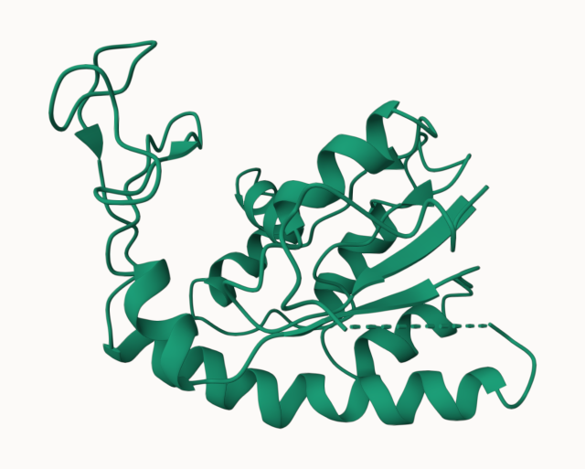

## Background 

Here we complete Lab 9 section 5, all bout comparative analysis of protein structures. 

## Set up 

Load the packages we need for our full analysis: 

```{r}
library(ggplot2)
library(bio3d)
library(msa)
```

>Q10. Which of the packages above is found only on BioConductor and not CRAN? 

The "msa" package is found only on BioConductor and not CRAN! 

>Q11. Which of the above packages is not found on BioConductor or CRAN?:

The bio3dview package is not foudn in either system because it is found in GitHub!

>Q12. True or False? Functions from the pak package can be used to install packages from GitHub and BitBucket? 

TRUE 

## Analysis Pipeline 

The main input will be a single database ID (accession number). We can change this in the future to run our analysis on any protein family.

```{r}
id <- "1ake_A"
```

```{r}
aa <- get.seq(id)
aa
```

>Q13. How many amino acids are in this sequence, i.e. how long is this sequence? 

214 amino acids! 

```{r}
# Blast or hmmer search 
#b <- blast.pdb(aa)
```

```{r}
hits <- NULL
hits$pdb.id <- c('1AKE_A','6S36_A','6RZE_A','3HPR_A','1E4V_A','5EJE_A','1E4Y_A','3X2S_A','6HAP_A','6HAM_A','4K46_A','3GMT_A','4PZL_A')
```

```{r}
# Download releated PDB files
files <- get.pdb(hits$pdb.id, path="pdbs", split=TRUE, gzip=TRUE)
```

```{r}
# Align releated PDBs
pdbs <- pdbaln(files, fit = TRUE, exefile="msa")
```

```{r}
pdbs
```

```{r}
library(bio3dview)

view.pdbs(pdbs)
```

```{r}
# Vector containing PDB database codes
ids <- basename.pdb(pdbs$id)

anno <- pdb.annotate(ids)
unique(anno$source)
```

```{r}
anno
```

```{r}
# Perform PCA
pc.xray <- pca(pdbs)
plot(pc.xray)
```

```{r}
# Calculate RMSD
rd <- rmsd(pdbs)

# Structure-based clustering
hc.rd <- hclust(dist(rd))
grps.rd <- cutree(hc.rd, k=3)

plot(pc.xray, 1:2, col="grey50", bg=grps.rd, pch=21, cex=1)
```

```{r}
view.pca(pc.xray)
```

```{r}
# Visualize first principal component
pc1 <- mktrj(pc.xray, pc=1, file="pc_1.pdb")
```

We can view this trajectory in Mol-star...



We can also plot our main PCA results with ggplot: 

```{r}
#Plotting results with ggplot2
library(ggplot2)
library(ggrepel)

df <- data.frame(PC1=pc.xray$z[,1], 
                 PC2=pc.xray$z[,2], 
                 col=as.factor(grps.rd),
                 ids=ids)

p <- ggplot(df) + 
  aes(PC1, PC2, col=col, label=ids) +
  geom_point(size=2) +
  geom_text_repel(max.overlaps = 20) +
  theme(legend.position = "none")
p
```

## Normal Mode Analysis 

```{r}
# NMA of all structures
modes <- nma(pdbs)
```

```{r}
plot(modes, pdbs, col=grps.rd)
```


>Q14. What do you note about this plot? Are the black and colored lines similar or different? Where do you think they differ most and why?

The colored vs black lines are similar in shape and the way they curve. However, the main thing that differs is that the colored lines peak higher. THis especially visual in the residues around 40-60 and then later on at 120-150. These fluctuations happen because it is most likely because they are involved in changes of the Adenylate kinase during the substrate binding/release!  
