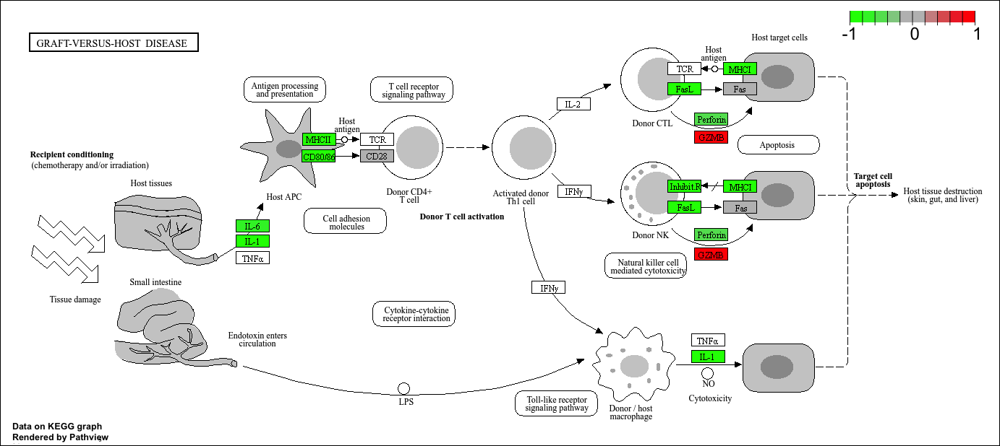
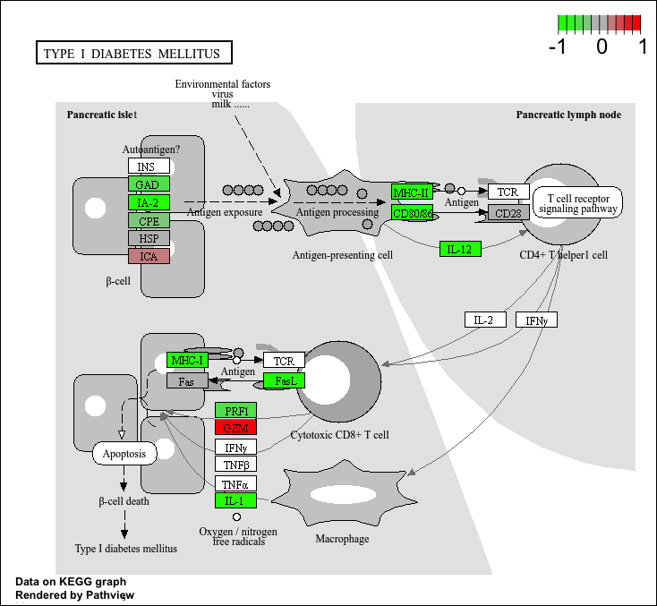

### BioConductor Setup 

Load needed packages into the R console and then check to make sure they have loaded: 

```{r}
library(BiocManager)
library(DESeq2)
```

### Data Import 

```{r}
# Complete the missing code
counts <- read.csv("airway_scaledcounts.csv", row.names=1)
metadata <-  read.csv("airway_metadata.csv")

```

```{r}
head(counts)
```

```{r}
head(metadata)
```

>Q1. How many genes are in this dataset?

```{r}
nrow(counts)
```


>Q2. How many ‘control’ cell lines do we have?

```{r}
nrow(metadata[metadata$dex == "control", ])
```

### Toy Differential Gene Expression

First, find the control samples and then select control counts
```{r}
control <- metadata[metadata[,"dex"]=="control",]
control.counts <- counts[ ,control$id]
control.mean <- rowSums( control.counts )/4 
head(control.mean)
```

>Q3. How would you make the above code in either approach more robust? Is there a function that could help here?

```{r}
control.mean <- rowMeans(control.counts)

head(control.mean)
```


>Q4. Follow the same procedure for the treated samples (i.e. calculate the mean per gene across drug treated samples and assign to a labeled vector called treated.mean)

```{r}

treated <- metadata[metadata[,"dex"]=="treated",]
treated.mean <- rowMeans(counts[,treated$id])

head(treated.mean)
```
We will combine our meancount data for bookkeeping purposes: 

```{r}
meancounts <- data.frame(control.mean, treated.mean)
colSums(meancounts)
```

>Q5A. Create a scatter plot showing the mean of the treated samples against the mean of the control samples. Your plot should look something like the following.

```{r}
plot(meancounts[,1],meancounts[,2], xlab="Control", ylab="Treated")
```

>Q5B. You could also use the ggplot2 package to make this figure producing the plot below. What geom_?() function would you use for this plot?
 
geom_point()
  
```{r}
library(ggplot2)

ggplot(meancounts, aes(x=control.mean, y=treated.mean)) +
  geom_point()
```

>Q6. Try plotting both axes on a log scale. What is the argument to plot() that allows you to do this?

Log="xy" 

```{r}
plot(meancounts[,1], meancounts[,2],
     xlab="log Control",
     ylab="log Treated",
     log="xy")
```

We can find candidate differentially expressed genes by looking for genes with a large change between control and dex-treated samples: 

```{r}
meancounts$log2fc <- log2(meancounts[,"treated.mean"]/meancounts[,"control.mean"])
head(meancounts)
```

Now, filter the data to remove genes with zero expression: 

```{r}
zero.vals <- which(meancounts[,1:2]==0, arr.ind=TRUE)

to.rm <- unique(zero.vals[,1])
mycounts <- meancounts[-to.rm,]
head(mycounts)
```

>Q7.  What is the purpose of the arr.ind argument in the which() function call above? Why would we then take the first column of the output and need to call the unique() function?

The purpose of the arr.ind argument will make which() to return both row and column positions where zero values can be found. We would take the first column and call it the unique() function because it identifies the rows that contains zero coutns. Using the unique() ensures that each gene can only be counted once. 


A common threshold used for calling something differentially expressed: 

```{r}
up.ind <- mycounts$log2fc > 2
down.ind <- mycounts$log2fc < (-2)
```

>Q8.  Using the up.ind vector above can you determine how many up regulated genes we have at the greater than 2 fc level?

```{r}
up.ind <- mycounts$log2fc > 2

paste("Up:", sum(up.ind))
```

>Q9. Using the down.ind vector above can you determine how many down regulated genes we have at the greater than 2 fc level? 

```{r}
down.ind <- mycounts$log2fc < -2

paste("Down:", sum(down.ind))
```


>Q10. Do you trust these results? Why or why not?

I think that i would not be able to trust these results because we only used fold change to determine the differentially expressed genes. Being a large fold change cannot mean that it is statistically significant. I think that the most accurate determination of this is the p-value which can be very misleading. 

### Setting up for DESeq 

First, load DESeq into the R console and see if it runs: 

```{r}
library(DESeq2)
citation("DESeq2")
```

Now, we will import data by using a custom class object to store data aka DESeqDataSet: 

```{r}
dds <- DESeqDataSetFromMatrix(countData=counts, 
                              colData=metadata, 
                              design=~dex)
dds
```

###PCA 

Before running DESeq analysis we can look how the count data samples are related to one another via PCA: 

```{r}
vsd <- vst(dds, blind = FALSE)
plotPCA(vsd, intgroup = c("dex"))
```

```{r}
pcaData <- plotPCA(vsd, intgroup=c("dex"), returnData=TRUE)
head(pcaData)
```

```{r}
# Calculate percent variance per PC for the plot axis labels
percentVar <- round(100 * attr(pcaData, "percentVar"))
```

```{r}
library(ggplot2) 

ggplot(pcaData) +
  aes(x = PC1, y = PC2, color = dex) +
  geom_point(size =3) +
  xlab(paste0("PC1: ", percentVar[1], "% variance")) +
  ylab(paste0("PC2: ", percentVar[2], "% variance")) +
  coord_fixed() +
  theme_bw()
```

### DESeq Analysis 

Finally, let’s run the DESeq analysis pipeline on the dataset, and reassign the resulting object back to the same variable. 

```{r}
library(DESeq2)
```

```{r}
dds <- DESeq(dds)

```

```{r}
res <- results(dds)
res
```

We can summarize some basic tallies using the summary function: 
```{r}
summary(res)
```
Readjust p value:

```{r}
res05 <- results(dds, alpha=0.05)
summary(res05)
```

### Adding Annotation Data

Load annotation packages
```{r}
library(AnnotationDbi)
library(org.Hs.eg.db)
```

To get a list of all available key types that we can use to map between, use the columns() function:
```{r}
columns(org.Hs.eg.db)
```

Now, we can use the mapIds() function to add individual columns to our results table: 

```{r}
res$symbol <- mapIds(org.Hs.eg.db,
                     keys=row.names(res), # Our genenames
                     keytype="ENSEMBL",        # The format of our genenames
                     column="SYMBOL",          # The new format we want to add
                     multiVals="first")
```

```{r}
head(res)
```

>Q11. Run the mapIds() function two more times to add the Entrez ID and UniProt accession and GENENAME as new columns called res$entrez, res$uniprot and res$genename.

```{r}
res$entrez <- mapIds(org.Hs.eg.db,
                     keys=row.names(res),
                     column="ENTREZID",
                     keytype="ENSEMBL",
                     multiVals="first")

res$uniprot <- mapIds(org.Hs.eg.db,
                     keys=row.names(res),
                     column="UNIPROT",
                     keytype="ENSEMBL",
                     multiVals="first")

res$genename <- mapIds(org.Hs.eg.db,
                     keys=row.names(res),
                     column="GENENAME",
                     keytype="ENSEMBL",
                     multiVals="first")

head(res)
```

Now arrange and view the results by the adjusted p-value: 

```{r}
ord <- order( res$padj )
#View(res[ord,])
head(res[ord,])
```

Let’s write out the ordered significant results with annotations: 
```{r}
write.csv(res[ord,], "deseq_results.csv")
```

### Data Visualization

Let's make a volcano plot: 

```{r}
plot( res$log2FoldChange,  -log(res$padj), 
      xlab="Log2(FoldChange)",
      ylab="-Log(P-value)")
```
Now add more guidelines and color: 

```{r}
plot( res$log2FoldChange,  -log(res$padj), 
 ylab="-Log(P-value)", xlab="Log2(FoldChange)")

# Add some cut-off lines
abline(v=c(-2,2), col="darkgray", lty=2)
abline(h=-log(0.05), col="darkgray", lty=2)
```

To color the points we will setup a custom color vector indicating transcripts with large fold change and significant differences between conditions:

```{r}
# Setup our custom point color vector 
mycols <- rep("gray", nrow(res))
mycols[ abs(res$log2FoldChange) > 2 ]  <- "red" 

inds <- (res$padj < 0.01) & (abs(res$log2FoldChange) > 2 )
mycols[ inds ] <- "blue"

# Volcano plot with custom colors 
plot( res$log2FoldChange,  -log(res$padj), 
 col=mycols, ylab="-Log(P-value)", xlab="Log2(FoldChange)" )

# Cut-off lines
abline(v=c(-2,2), col="gray", lty=2)
abline(h=-log(0.1), col="gray", lty=2)

```

Now, add even more customization with the EnhancedVolcano bioconductor package

```{r}
library(EnhancedVolcano)
```

```{r}
x <- as.data.frame(res)

EnhancedVolcano(x,
    lab = x$symbol,
    x = 'log2FoldChange',
    y = 'pvalue')
```

### Pathway and Analysis 

First, Load the packages 

```{r}
library(pathview)
library(gage)
library(gageData)

data(kegg.sets.hs)

# Examine the first 2 pathways in this kegg set for humans
head(kegg.sets.hs, 2)
```

```{r}
foldchanges = res$log2FoldChange
names(foldchanges) = res$entrez
head(foldchanges)
```
Now, let's run the gage pathway analysis: n

```{r}
# Get the results
keggres = gage(foldchanges, gsets=kegg.sets.hs)
```

```{r}
attributes(keggres)
```

```{r}
# Look at the first three down (less) pathways
head(keggres$less, 3)
```

```{r}
pathview(gene.data=foldchanges, pathway.id="hsa05310")
```

>Q12. Can you do the same procedure as above to plot the pathview figures for the top 2 down-reguled pathways?

```{r}
# Graft-versus-host disease
pathview(gene.data=foldchanges, pathway.id="hsa05332")

# Type I diabetes mellitus
pathview(gene.data=foldchanges, pathway.id="hsa04940")
```




