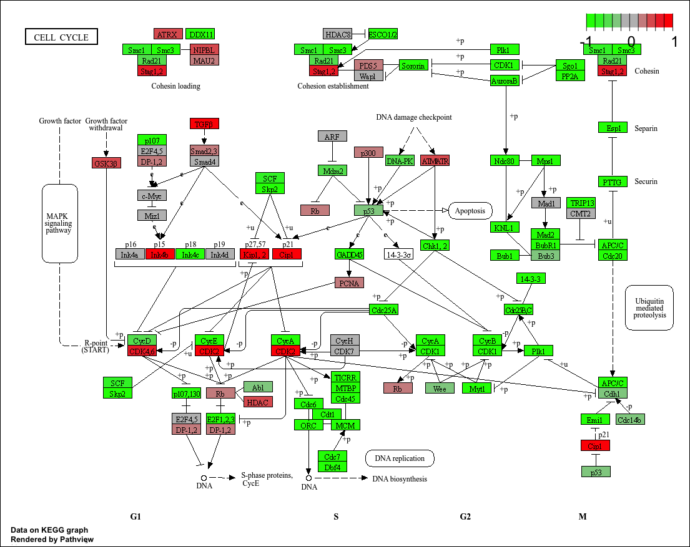
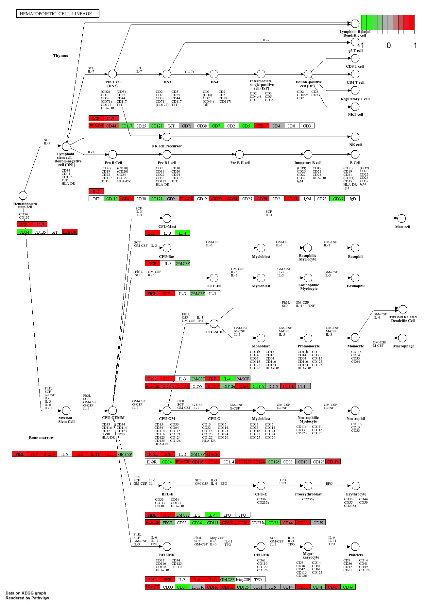
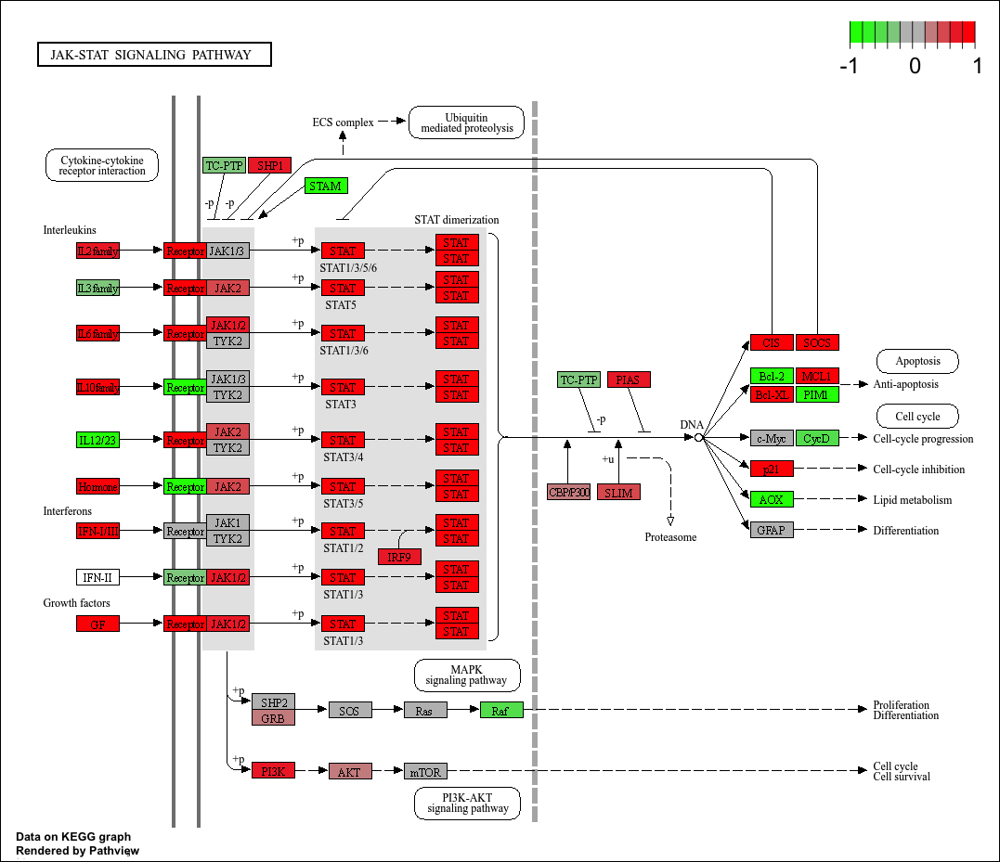
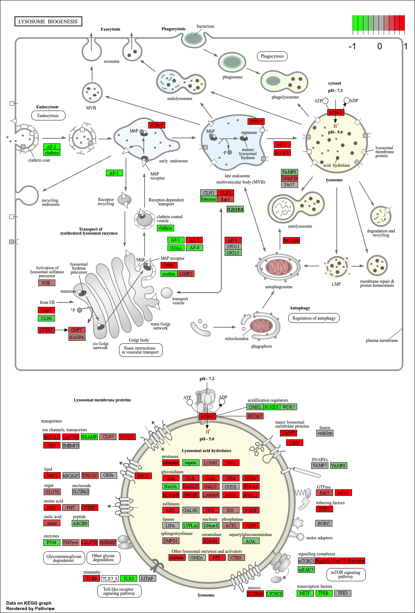
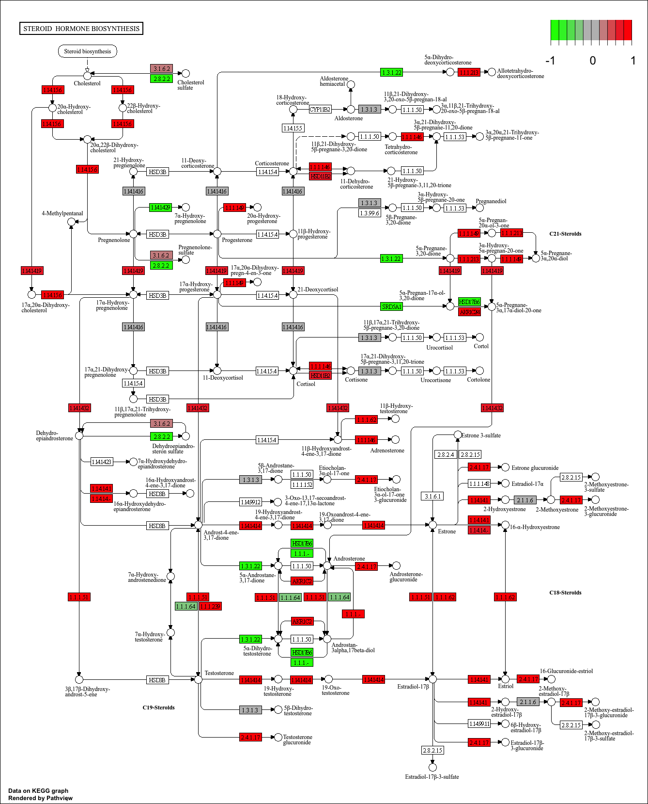
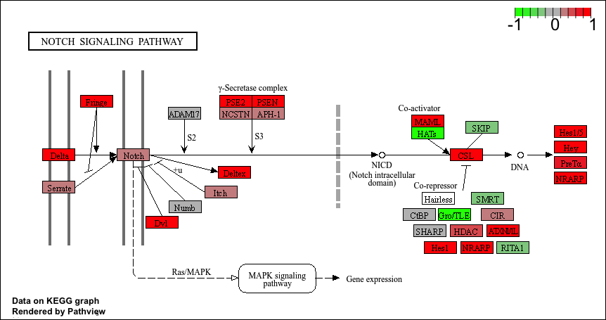
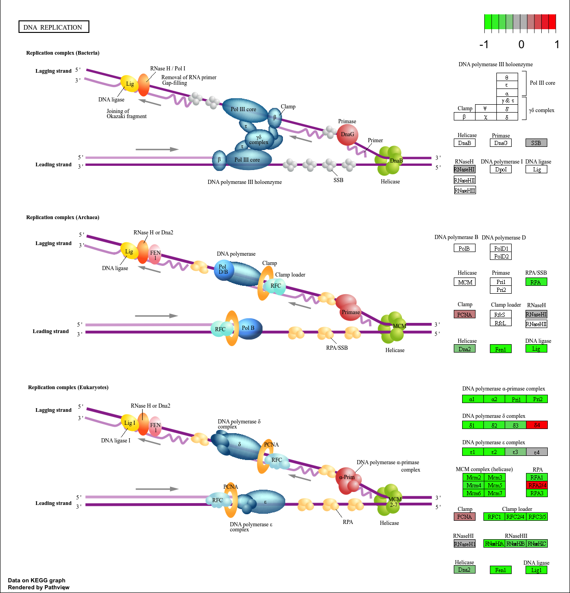
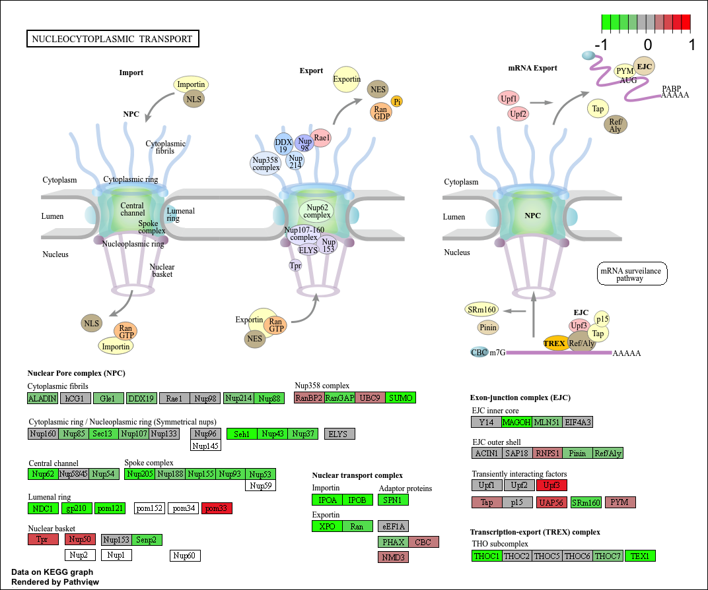
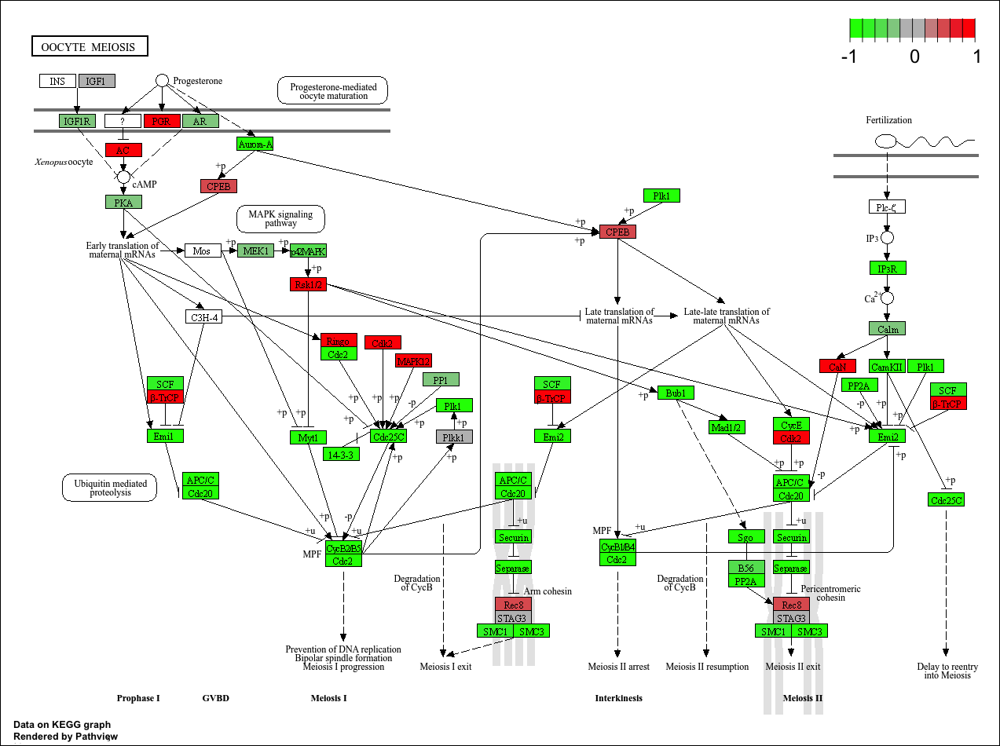
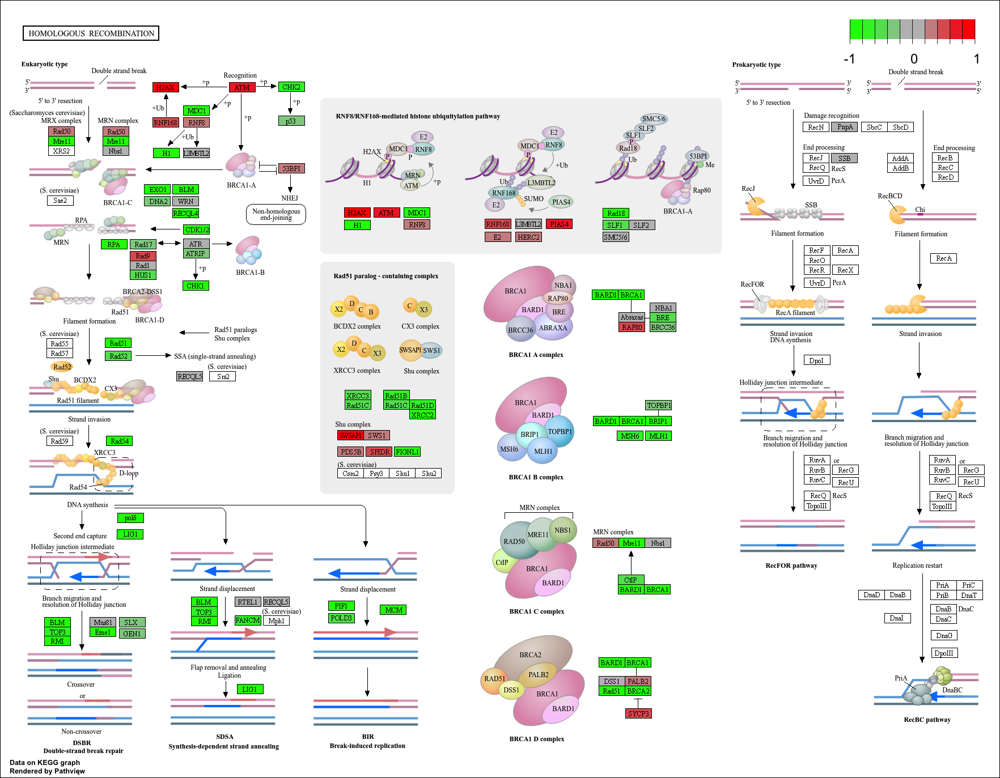

## Section 1: Differential Expression and Analysis 

```{r}
library(DESeq2)

```

```{r}
metaFile <- "GSE37704_metadata.csv"
countFile <- "GSE37704_featurecounts.csv"
```

```{r}
# Import metadata and take a peek
colData = read.csv(metaFile, row.names=1)
head(colData)
```

```{r}
countData = read.csv(countFile, row.names=1)
head(countData)
```

>Q1. Complete the code below to remove the troublesome first column from countData

```{r}
countData <- as.matrix(countData[,-1])
head(countData)
```

>Q2. Complete the code below to filter countData to exclude genes (i.e. rows) where we have 0 read count across all samples (i.e. columns).

```{r}
countData <- countData[rowSums(countData) > 0, ]

head(countData)
```

Now let's set up DESeq()

```{r}
# Create the DESeqDataSet object
dds <- DESeqDataSetFromMatrix(countData=countData,
                              colData=colData,
                              design=~condition)

# Run the DESeq analysis
dds <- DESeq(dds)

# View the results
dds
```

```{r}
res = results(dds)
```

>Q3.  Call the summary() function on your results to get a sense of how many genes are up or down-regulated at the default 0.1 p-value cutoff.

```{r}
summary(res)
```
Now, it's time for the Volcano Plot: 

```{r}
library(ggplot2)

ggplot(res) +
  aes(x = log2FoldChange,
      y = -log(padj)) +
  geom_point()
```

>Q4.  Improve this plot by completing the below code, which adds color, axis labels and cutoff lines:

```{r}
# Make a color vector for all genes
mycols <- rep("gray", nrow(res))

# Color blue the genes with fold change above 2
mycols[!is.na(res$log2FoldChange) &
       abs(res$log2FoldChange) > 2] <- "blue"

# Color gray those with adjusted p-value more than 0.01
mycols[is.na(res$padj) | res$padj > 0.01] <- "gray"

# Create volcano plot
ggplot(as.data.frame(res)) +
  aes(x = log2FoldChange,
      y = -log(padj)) +
  geom_point(color = mycols) +
  xlab("Log2(FoldChange)") +
  ylab("-Log(P-value)") +
  geom_vline(xintercept = c(-2,2)) +
  geom_hline(yintercept = -log(0.01))
```

Now, add gene annotation: 

```{r}
library(AnnotationDbi)
library(org.Hs.eg.db)

columns(org.Hs.eg.db)

res$symbol <- mapIds(org.Hs.eg.db,
                     keys=row.names(res),
                     keytype="ENSEMBL",
                     column="SYMBOL",
                     multiVals="first")

res$entrez <- mapIds(org.Hs.eg.db,
                     keys=row.names(res),
                     keytype="ENSEMBL",
                     column="ENTREZID",
                     multiVals="first")

res$name <- mapIds(org.Hs.eg.db,
                   keys=row.names(res),
                   keytype="ENSEMBL",
                   column="GENENAME",
                   multiVals="first")

head(res, 10)
```

>Q5. Finally for this section let's reorder these results by adjusted p-value and save them to a CSV file in your current project directory.

```{r}
res <- res[order(res$padj),]
write.csv(res, file="deseq_results.csv")
```

## Section 2: Pathway Analysis 

Load the packages and setup the KEGG data-sets

```{r}
library(pathview)
library(gage)
library(gageData)

data(kegg.sets.hs)
data(sigmet.idx.hs)

# Focus on signaling and metabolic pathways only
kegg.sets.hs = kegg.sets.hs[sigmet.idx.hs]

# Examine the first 3 pathways
head(kegg.sets.hs, 3)
```

```{r}
foldchanges = res$log2FoldChange
names(foldchanges) = res$entrez
head(foldchanges)
```

```{r}
# Get the results
keggres = gage(foldchanges, gsets=kegg.sets.hs)

```

```{r}
attributes(keggres)
```

```{r}
# Look at the first few down (less) pathways
head(keggres$less)
```

```{r}
# Generate the Cell cycle pathway diagram
pathview(gene.data=foldchanges, pathway.id="hsa04110")
```

Display the image: 



```{r}
# A different PDF based output of the same data
pathview(gene.data=foldchanges, pathway.id="hsa04110", kegg.native=FALSE)
```


Now, let's do it for the top 5 up-unregualted pathways 

```{r}
## Focus on top 5 upregulated pathways here for demo purposes only
keggrespathways <- rownames(keggres$greater)[1:5]

# Extract the 8 character long IDs part of each string
keggresids = substr(keggrespathways, start=1, stop=8)
keggresids
```

Now, generate the pathway diagrams: 

```{r}
pathview(gene.data=foldchanges, pathway.id=keggresids, species="hsa")
```
Display all: 


### Up-regulated Pathway 1


### Up-regulated Pathway 2


### Up-regulated Pathway 3


### Up-regulated Pathway 4


### Up-regulated Pathway 5


>Q6.  Can you do the same procedure as above to plot the pathview figures for the top 5 down-regulated pathways?

```{r}
keggrespathways.down <- rownames(keggres$less)[1:5]

keggresids.down <- substr(keggrespathways.down, start=1, stop=8)

keggresids.down
```

```{r}
pathview(gene.data=foldchanges,
         pathway.id=keggresids.down,
         species="hsa")
```

#### 1. Cell Cycle


#### 2. DNA Replication


#### 3. RNA Transport


#### 4. Oocyte Meiosis


#### 5. Homologous Recombination



## Section 3: Gene Ontology 

A similar procedure can be done with gene ontology

```{r}
data(go.sets.hs)
data(go.subs.hs)

# Focus on Biological Process subset of GO
gobpsets = go.sets.hs[go.subs.hs$BP]

gobpres = gage(foldchanges, gsets=gobpsets)

lapply(gobpres, head)
```

## Section 4: Reactome Analysis

```{r}
sig_genes <- res[res$padj <= 0.05 & !is.na(res$padj), "symbol"]
print(paste("Total number of significant genes:", length(sig_genes)))
```

```{r}
write.table(sig_genes, file="significant_genes.txt", row.names=FALSE, col.names=FALSE, quote=FALSE)
```

>Q7. What pathway has the most significant “Entities p-value”? Do the most significant pathways listed match your previous KEGG results? What factors could cause differences between the two methods?

The most significant p value would be the Cell Cycle, Mitotic which has a p-value of 1.48 x 10^-4 and a FDR of 2.36 x 10^-2. The Reactome results are consistent with the KEGG analysis because they both analyzed the cell cycle as an impacted pathway. Yet, differences are seen in the methods because Reactome and Kegg utilize different pathway databases, gene anotations, and stats; approach. Reactome uses lsit of signicant genes while Kegg uses tools such as GAGE and gene expression fold changes. 